<div align="center">

# 웹프로그래밍응용_기말프로젝트_쇼핑몰

**필살기** — 커스텀 영양제 쇼핑몰

</div>

#### Languages


#### Tools


#### Platform


#### Server


#### AI Agent


---
## Table of Contents

- [Project Overview](#project-overview)
- [아키텍처 명세](#아키텍처-명세architecture)
- [DB 설계 명세](#db-설계-명세database)
  - [ERD](#erd)
  - [테이블 명세](#테이블-명세tables)
  - [DDL](#ddl)
- [기능 구현 명세](#기능-구현-명세features)
- [핵심 구현 명세](#핵심-구현-명세implementation)
- [URL 매핑 명세](#url-매핑-명세url-mapping)
- [UI](#ui)
- [Project Structure](#project-structure)
- [Build & Run](#build--run)
  - [Prerequisites](#prerequisites)
  - [DB 초기화](#db-초기화)
  - [Eclipse 설정](#eclipse-설정)
  - [Run](#run)
  - [Deploy (WAR)](#deploy-war)
- [License](#license)
- [Author](#author)
- [Motivation](#motivation)
---

## Project Overview

- **컨셉**: 커스텀 영양제 쇼핑몰. 판매 단위는 1포(하루분)이고 장바구니 수량은 섭취 일수다. 낱개 영양제 38종과 미리 구성한 트랙 패키지 11종을 팔고, 사용자가 직접 낱개를 골라 조합을 만들 수 있다. 함께 먹으면 안 되는 조합과 같은 영양제를 두 번 먹게 되는 조합에는 경고를 띄운다.
- **아키텍처**: `model` · `dao` · `service`(서블릿) · `llm` 4패키지 MVC. 뷰는 `WebContents/{기능}/*.jsp` + JSTL
- **DB 연동**: Tomcat JNDI DataSource `jdbc/shop` (commons-dbcp 커넥션 풀) · MySQL 9.6 · 스키마 `shopdb`
- **인증 방식**: 세션 로그인 + 2역할 완전 격리 (`USER` 구매 / `ADMIN` 상품 · 주문 관리)
- **AI 기능**: 학교 GPU 서버의 Ollama(`gemma3:12b`)로 상품 설명 요약 · 리뷰 요약 · 연관 상품 추천

---

## 아키텍처 명세(Architecture)

| 계층 | 구성 요소 | 역할 |
|---|---|---|
| Controller | `shop.service` — `*Servlet` 10개 + `BaseServlet` | `@WebServlet` 정확 일치 매핑, 입장 검사(로그인 · 역할 · 점검 모드), 입력 검사 · 업무 규칙 · 트랜잭션, JSP forward |
| Model | `shop.model` (12) · `shop.dao` (11) | `model` 은 테이블 한 행을 담는 객체, `dao` 는 SQL 실행. `DB` 가 커넥션 · 트랜잭션 · 결과 → 객체 변환을 맡는다 |
| View | `WebContents/{기능}/*.jsp` (39) | JSTL · EL 렌더링만. 팝업은 `<dialog>` 인페이지 모달 |
| LLM | `shop.llm` (6) | `OllamaClient` 로 모델 호출, `LlmWorker`(`@WebListener`) 가 요약을 백그라운드에서 만든다 |
| Filter | `web.xml` | UTF-8 요청 · 응답 인코딩, CSS · JS 재검증(`ExpiresFilter`), 404 · 500 오류 페이지 |

```
요청 ─▶ BaseServlet 입장 검사 (점검 모드 · USER / ADMIN 영역)
     ─▶ *Servlet (검사 · 규칙) ─▶ *DAO ─▶ DB (JNDI jdbc/shop) ─▶ MySQL shopdb
     ◀─ {기능}/*.jsp (forward) ◀─ model 객체

상품 상세 ─▶ LlmService.summariesFor() ─▶ llm_summary (저장된 요약만 읽는다)
                    └─ 없거나 낡았으면 ─▶ LlmWorker 줄 ─▶ OllamaClient ─▶ localhost:31434 ─▶ 학교 GPU 서버
```

---

## DB 설계 명세(Database)

### ERD

테이블 22 · 뷰 5 · FK 29 · UNIQUE 11 · CHECK 6. 설계 근거는 [sql/schema.sql](sql/schema.sql) 의 주석에 있다.

```mermaid
erDiagram
  MEMBER ||--o{ ADDRESS : "배송지"
  MEMBER ||--o{ CART : "담기"
  MEMBER ||--o{ WISHLIST : "찜"
  MEMBER ||--o{ COMBO : "내 조합"
  MEMBER ||--o{ ORDERS : "주문"
  MEMBER ||--o{ REVIEW : "작성"
  MEMBER ||--o{ QNA : "문의"
  MEMBER |o--o{ DELIVERY_HISTORY : "상태변경"
  MEMBER ||--o{ ADMIN_LOG : "조작"
  CATEGORY |o--o{ CATEGORY : "하위"
  CATEGORY ||--o{ PRODUCT : "분류"
  PRODUCT ||--o{ TRACK_ITEM : "트랙 구성"
  PRODUCT ||--o{ SUPPLEMENT_CONFLICT : "금지 조합"
  PRODUCT ||--o{ PRODUCT_IMAGE : "이미지"
  PRODUCT ||--o{ CART : "담김"
  PRODUCT ||--o{ WISHLIST : "찜됨"
  PRODUCT ||--o{ COMBO_ITEM : "조합 구성"
  PRODUCT ||--o{ ORDER_ITEM : "판매"
  PRODUCT ||--o{ REVIEW : "평가"
  PRODUCT ||--o{ QNA : "질문"
  PRODUCT ||--o{ LLM_SUMMARY : "AI 요약"
  COMBO ||--|{ COMBO_ITEM : "포함"
  ORDERS ||--|{ ORDER_ITEM : "포함"
  ORDERS ||--|| PAYMENT : "결제"
  ORDERS ||--|| DELIVERY : "배송"
  DELIVERY ||--|{ DELIVERY_HISTORY : "이력"
  ORDER_ITEM ||--o| REVIEW : "구매후기"

  MEMBER {
    int member_id PK
    varchar login_id UK
    varchar password
    varchar name
    varchar email UK
    varchar phone
    enum role "USER/ADMIN"
    enum status "ACTIVE/LEFT"
    datetime created_at
  }
  ADDRESS {
    int addr_id PK
    int member_id FK
    varchar addr_name
    varchar receiver
    varchar receiver_phone
    varchar zipcode
    varchar addr1
    varchar addr2
    enum is_default "Y/N"
  }
  CATEGORY {
    int category_id PK
    int parent_id FK
    varchar name
    int sort_order
  }
  PRODUCT {
    int product_id PK
    int category_id FK
    enum product_type "SINGLE/TRACK"
    varchar name
    int price "1포 가격"
    int stock "남은 포 수"
    text description
    text notice_info "product_detail.sql"
    text detail_images "product_detail.sql"
    varchar thumbnail
    enum status "판매중/숨김"
    datetime created_at
  }
  TRACK_ITEM {
    int track_id PK,FK
    int item_id PK,FK
    int sort_order
  }
  SUPPLEMENT_CONFLICT {
    int conflict_id PK
    int product_a FK
    int product_b FK
    varchar message
    datetime created_at
  }
  PRODUCT_IMAGE {
    int image_id PK
    int product_id FK
    varchar img_path
    int sort_order
  }
  CART {
    int cart_id PK
    int member_id FK
    int product_id FK
    int quantity "섭취 일수"
    datetime added_at
  }
  WISHLIST {
    int member_id PK,FK
    int product_id PK,FK
    datetime created_at
  }
  COMBO {
    int combo_id PK
    int member_id FK
    varchar name
    int days
    datetime created_at
    datetime updated_at
  }
  COMBO_ITEM {
    int combo_id PK,FK
    int product_id PK,FK
    int sort_order
  }
  ORDERS {
    int order_id PK
    varchar order_no UK
    int member_id FK
    int total_price
    int delivery_fee
    enum order_status "정상/취소"
    varchar receiver
    varchar receiver_phone
    varchar zipcode
    varchar addr1
    varchar addr2
    varchar delivery_memo
    datetime ordered_at
    datetime canceled_at
  }
  ORDER_ITEM {
    int item_id PK
    int order_id FK
    int product_id FK
    varchar product_name
    int price
    int quantity
    varchar track_snapshot
  }
  PAYMENT {
    int payment_id PK
    int order_id FK,UK
    enum method "카드/무통장/간편결제"
    int amount
    enum pay_status "완료/환불"
    datetime paid_at
    datetime refunded_at
  }
  DELIVERY {
    int delivery_id PK
    int order_id FK,UK
    enum status "결제완료/상품준비/배송중/배송완료"
    varchar courier
    varchar tracking_no
    datetime paid_at
    datetime ready_at
    datetime shipped_at
    datetime delivered_at
  }
  DELIVERY_HISTORY {
    int history_id PK
    int delivery_id FK
    enum prev_status
    enum new_status
    int changed_by FK
    datetime changed_at
  }
  REVIEW {
    int review_id PK
    int member_id FK
    int product_id FK
    int item_id FK,UK
    tinyint rating
    varchar content
    datetime created_at
  }
  QNA {
    int qna_id PK
    int member_id FK
    int product_id FK
    varchar question
    enum is_secret "Y/N"
    varchar answer
    datetime created_at
    datetime answered_at
  }
  NOTICE {
    int notice_id PK
    varchar title
    text content
    int view_count
    datetime created_at
  }
  SYSTEM_CONFIG {
    varchar config_key PK
    varchar config_value
    varchar description
    datetime updated_at
  }
  ADMIN_LOG {
    int log_id PK
    int member_id FK
    varchar action
    varchar target_table
    int target_id
    varchar detail
    datetime created_at
  }
  LLM_SUMMARY {
    int product_id PK,FK
    enum summary_type PK "DESC/REVIEW"
    varchar content
    char source_key
    datetime created_at
  }
```



### 테이블 명세(Tables)

| 테이블 | 설명 | 주요 컬럼 |
|---|---|---|
| `member` | 회원 | `login_id` · `password` · `name` · `role`(USER/ADMIN) · `status`(ACTIVE/LEFT, 소프트 삭제) |
| `address` | 회원 배송지 | `member_id` · 수령인 · 우편번호 · 주소 · `is_default` |
| `category` | 카테고리 (자기참조 계층) | `parent_id` · `name` · `sort_order` |
| `product` | 상품 — 낱개(SINGLE) · 트랙 패키지(TRACK) | `product_type` · `price`(1포) · `stock`(포) · `status`(판매중/숨김) · `thumbnail` · `notice_info` · `detail_images` |
| `track_item` | 트랙 패키지의 구성 낱개 | `track_id` · `item_id` · `sort_order` |
| `supplement_conflict` | 함께 먹으면 안 되는 낱개 조합 | `product_a` < `product_b` · `message` |
| `product_image` | 상품 추가 이미지 | `product_id` · `img_path` · `sort_order` |
| `cart` | 장바구니 | `member_id` · `product_id` · `quantity`(섭취 일수) |
| `wishlist` | 찜 | `member_id` · `product_id` |
| `combo` · `combo_item` | 내 조합 (직접 고른 낱개 묶음) | `name` · `days` · 구성 낱개 |
| `orders` | 주문 | `order_no` · `member_id` · `total_price` · `delivery_fee` · `order_status` · 배송지 · `canceled_at` |
| `order_item` | 주문 상품 (주문 시점 스냅샷) | `product_name` · `price` · `quantity` · `track_snapshot`(트랙 구성) |
| `payment` | 결제 (모의) | `method` · `amount` · `pay_status` · `refunded_at` |
| `delivery` | 배송 | `status` · `courier` · `tracking_no` · 단계별 시각 |
| `delivery_history` | 배송 상태 이력 (주문 상세 타임라인) | `prev_status` · `new_status` · `changed_by`(NULL 이면 시스템) |
| `review` | 리뷰 (구매 건당 1회) | `item_id` · `product_id` · `rating` · `content` |
| `qna` | 상품 문의 | `question` · `is_secret` · `answer` · `answered_at` |
| `notice` | 공지사항 | `title` · `content` · `view_count` |
| `system_config` | 전역 설정 | `SHOP_STATUS` · `DELIVERY_FEE` · `FREE_SHIPPING_MIN` · `LOW_STOCK_THRESHOLD` · `MAX_INTAKE_DAYS` |
| `admin_log` | 관리자 조작 기록 | `member_id` · `action` · `target_table` · `target_id` · `detail` |
| `llm_summary` | AI 요약 저장 | `product_id` · `summary_type`(DESC/REVIEW) · `content` · `source_key`(원본 해시) |

| 뷰 | 용도 |
|---|---|
| `v_sales_daily` | 일별 매출 (정상 주문만) |
| `v_delivery_status_count` | 배송 상태별 건수 |
| `v_admin_order` | 관리자 주문 목록 (회원 · 결제 · 배송 · 상품 수 · 첫 상품명) |
| `v_admin_member` | 관리자 회원 목록 (주문 수 · 결제 합계 · 미답변 문의) |
| `v_low_stock` | 재고 부족 상품 (`LOW_STOCK_THRESHOLD` 이하) |

### DDL

| 순서 | 파일 | 내용 | 실행 계정 |
|---|---|---|---|
| 0 | [sql/00_create_database.sql](sql/00_create_database.sql) | `shopdb` 생성 + 개발 계정 권한 부여 (1회) | 관리자(root) |
| 1 | [sql/schema.sql](sql/schema.sql) | 테이블 · 뷰 생성 (재실행 가능) | 개발 계정 |
| 2 | [sql/data.sql](sql/data.sql) | 샘플 데이터 — 회원 · 카테고리 · 상품 49 · 금지 조합 · 주문 (재실행 시 전체 초기화) | 개발 계정 |
| 3 | [sql/llm_summary.sql](sql/llm_summary.sql) | `llm_summary` 테이블 (이미 쓰던 DB 에 추가할 때) | 개발 계정 |
| 4 | [sql/llm_test_data.sql](sql/llm_test_data.sql) | AI 요약 시험용 긴 설명 · 리뷰 · 주문 | 개발 계정 |
| 5 | [sql/review_data.sql](sql/review_data.sql) | 상품 설명 · 리뷰 보강 데이터 | 개발 계정 |
| 6 | [sql/product_detail.sql](sql/product_detail.sql) | 필수 표기정보 · 상세 이미지 컬럼과 데이터 | 개발 계정 |

---

## 기능 구현 명세(Features)

### 공개

- 메인 — 기획전 배너(드래그), 트랙 패키지, 신상품, 공지
- 상품 목록 — 카테고리 · 낱개/트랙 구분 · 검색 · 정렬(최신순 · 낮은 가격순 · 높은 가격순 · 별점순 · 이름순). 판매중이고 재고가 있는 상품만 보인다
- 상품 상세 — 상세보기 · 필수 표기정보 · 상세 이미지 · 리뷰(별점 분포) · 문의 탭, 함께 먹으면 안 되는 영양제 안내, AI 상품 설명 요약 · AI 리뷰 요약
- 검색 결과 아래 AI 추천 연관 상품 (비동기)
- 조합 맞추기(`/custom`) — 낱개를 고르고 섭취 일수를 정하면 금액 · 경고를 바로 계산, 트랙 패키지를 불러와 고치기, 조합 공유 주소
- 공지사항, 점검 안내 페이지

### 고객 (USER)

- 회원가입(아이디 중복 확인 · 실시간 입력 안내) · 로그인 · 정보 수정 · 비밀번호 변경 · 탈퇴
- 장바구니(수량 = 섭취 일수) · 찜 · 내 조합 저장 / 삭제
- 동시 섭취 경고 — 담은 상품끼리(트랙은 구성품으로 펼쳐서) 금지 조합 · 중복 섭취를 알린다
- 주문서(카카오 우편번호 검색) → 모의 결제 → 주문 완료 · 주문 내역 · 상세(배송 타임라인) · 취소(결제완료 · 상품준비 단계만)
- 배송지 관리(기본 배송지) · 리뷰 작성(배송완료 건, 구매 건당 1회) · 상품 문의(비밀글)

### 관리자 (ADMIN)

- 대시보드 — 일별 매출 · 배송 단계별 건수 · 재고 부족
- 상품 관리(대표 · 추가 이미지 업로드, 트랙 구성, 숨김) · 카테고리 · 금지 조합
- 주문 · 배송 관리 — 단계 전이(배송중으로 넘길 때 운송장 입력) · 주문 취소
- 회원 검색 · 탈퇴 처리, 공지 관리, 문의 답변, 리뷰 삭제
- AI 요약 전체 생성 (판매중 상품 전부를 백그라운드로)
- 모든 조작은 `admin_log` 에 기록

---

## 핵심 구현 명세(Implementation)

### 결제 트랜잭션

주문 → 주문 상품(트랙은 구성 스냅샷) → 재고 차감 → 결제 → 배송(결제완료) → 배송 이력 → 장바구니 비우기를 **한 트랜잭션**으로 처리한다. 재고 차감은 `UPDATE ... WHERE stock >= ?` 로 하고, 0행이면 전체를 rollback 해 동시 주문에서 재고가 음수가 되지 않게 한다.

```java
// OrderServlet — 결제
DB.begin();
try {
	int orderId = OrderDAO.insertOrder(memberId, total, fee, receiver, phone, ...);
	for (Item item : cart) {
		OrderDAO.insertItem(orderId, item, item.isTrack() ? snapshot(item.getProductId()) : null);
		if (ProductDAO.decreaseStock(item.getProductId(), item.getQuantity()) == 0) {
			throw new Fail("'" + item.getProductName() + "' 의 재고가 부족합니다.");
		}
	}
	OrderDAO.insertPaymentAndDelivery(orderId, method, total + fee);
	CartDAO.clear(memberId);
	DB.commit();
} finally {
	DB.end();
}
```

### 2역할 완전 격리

| 경로 | 비로그인 | USER | ADMIN |
|---|---|---|---|
| 공개 탐색 (메인 · 상품 · 조합 맞추기 · 공지) | ○ | ○ | ○ |
| 구매 (`/cart` · `/order` · `/mypage` · `/wish`) | 로그인으로 | ○ | ✕ |
| `/admin/*` | 로그인으로 | ✕ | ○ |

`BaseServlet` 이 모든 요청 앞에서 검사한다. 가입은 항상 `USER` 이고, `ADMIN` 계정은 `data.sql` 로만 만든다. 역할은 생성 후 바뀌지 않는다. 로그인 후에는 원래 보던 화면으로 돌아가되, 그 역할이 들어갈 수 있는 주소일 때만 돌아간다.

### 노출 규칙

상품을 찾아가는 모든 경로(목록 · 상세 · 조합 맞추기)는 `status = '판매중' AND stock > 0` 한 줄을 공통 조건으로 쓴다 (`ProductDAO.ON_SALE`). `status` 는 관리자의 전시 의도만 담고 재고를 모른다 — 재고가 0 이면 자동으로 숨고, 다시 들어오면 자동으로 보인다.

### 동시 섭취 경고

장바구니 · 조합 맞추기 · 상품 상세에서 고른 상품을 낱개 단위로 펼친다(트랙은 구성품으로). 그 사이에서 `supplement_conflict` 에 걸린 쌍은 "동시 섭취 주의", 같은 영양제가 두 번 이상 들어간 경우는 "중복 섭취" 로 알린다 (`ConflictDAO.warnings`).

### 배송 상태 전이

`UPDATE delivery SET status = ? WHERE status = <직전 상태>` 로 한 단계씩만 넘기고 0행이면 rollback 한다. 성공하면 `delivery_history` 와 `admin_log` 를 함께 기록한다. 배송중 · 배송완료 행은 운송장이 반드시 있어야 하고, 어기면 DB 의 CHECK 제약이 거부한다.

### AI 요약 · 추천

Ollama 응답이 수십 초 ~ 3분이라 화면을 그릴 때 모델을 부르지 않는다.

- **상품 설명 요약 · 리뷰 요약** — 상세 화면은 `llm_summary` 에 저장된 요약만 읽는다. 없거나 원본(설명 · 리뷰)의 해시가 바뀌었으면 상품 id 를 `LlmWorker` 줄에 세우고 바로 돌아간다. 일꾼 스레드가 차례로 모델을 불러 저장한다.
- **연관 상품 추천** — 검색어마다 달라 미리 만들 수 없다. `js/llm.js` 가 `/llm/related` 를 비동기로 부르고, 결과는 메모리에 캐시한다.
- 모델 주소는 `context.xml` 의 `llm/ollamaUrl` (`http://localhost:31434/api/generate`). 학교 GPU 서버는 학교 IP 만 받으므로 k8s 중계 파드를 거친다 ([tools/llm/start-relay.sh](tools/llm/start-relay.sh), [k8s/llm-relay.yaml](k8s/llm-relay.yaml)). 설정이 없거나 서버가 꺼져 있어도 앱은 뜨고, 요약이 아직 없는 상품은 "AI 요약을 준비하고 있어요" 안내와 함께 설명 앞부분을 보여준다.

### 점검 모드

`system_config.SHOP_STATUS` 가 `MAINTENANCE` 이면 `BaseServlet` 이 비로그인 · USER 요청을 점검 안내로 보낸다. 관리자 화면과 로그인은 통과한다.

---

## URL 매핑 명세(URL Mapping)

서블릿은 `@WebServlet` **정확 일치** 매핑만 쓴다. `/xxx/*` 와일드카드는 JSP 디렉터리와 접두어가 같아 forward 가 같은 서블릿으로 되돌아오는 무한 순환이 생긴다.

| 영역 | URL | Servlet | View (`WebContents/`) |
|---|---|---|---|
| 공개 | `/` · `/main` · `/maintenance` · `/notice/list` · `/notice/view` | `MainServlet` | `main/*.jsp` · `notice/*.jsp` |
| 공개 | `/member/join` · `/member/login` · `/member/logout` · `/member/idcheck` | `MemberServlet` | `member/*.jsp` |
| 공개 | `/product/list` · `/product/view` | `ProductServlet` | `product/*.jsp` |
| 공개 · USER | `/custom` · `/mypage/combo` · `/mypage/combo/save` · `/mypage/combo/delete` | `CustomServlet` | `custom/index.jsp` · `mypage/combo.jsp` |
| 공개 · ADMIN | `/llm/related` (JSON) · `/admin/llm/refresh` | `LlmServlet` | — |
| USER | `/cart/list` · `/cart/add` · `/cart/addAll` · `/cart/update` · `/cart/delete` · `/wish/toggle` · `/wish/remove` | `CartServlet` | `cart/list.jsp` |
| USER | `/order/form` · `/order/pay` · `/order/complete` · `/order/list` · `/order/view` · `/order/cancel` | `OrderServlet` | `order/*.jsp` |
| USER | `/mypage` · `/mypage/edit` · `/mypage/password` · `/mypage/leave` · `/mypage/address` · `/mypage/wishlist` · `/mypage/review` · `/mypage/qna` | `MypageServlet` | `mypage/*.jsp` |
| ADMIN | `/admin/dashboard` · `/admin/orders` · `/admin/members` · `/admin/notices` · `/admin/qna` · `/admin/reviews` | `AdminServlet` | `admin/*.jsp` |
| ADMIN | `/admin/products` · `/admin/categories` · `/admin/conflicts` | `AdminProductServlet` | `admin/*.jsp` |

팝업(문의 · 리뷰 · 배송지 · 상품 등록 · 카테고리 · 금지 조합 · 운송장 · 답변 · 공지)은 별도 라우트 없이 부모 화면의 `<dialog>` 로 열리고, 부모 화면의 URL 로 제출한다.

---

## UI

브랜드 **필살기** (Pill + 필살기) — 다크틸(신뢰 · 헬시) + 볼트옐로우(번개 · 임팩트). 색 · 글꼴 · 간격은 [css/base/variables.css](WebContents/css/base/variables.css) 의 `:root` 토큰 한 곳에서 정한다.

| 항목 | 내용 |
|---|---|
| CSS | 20개 — `base`(reset · variables · layout) · `components`(button · card · form · pagination · popup · tab · table · warnbox) · `pages`(화면별 9) |
| JS | `ui.js`(공통 동작 · 깨진 이미지 대체) · `validate.js`(폼 검증) · `custom.js`(조합 즉시 계산) · `prodtabs.js`(상세 탭) · `banner.js`(기획전 배너) · `llm.js`(AI 추천) · `postcode.js`(카카오 우편번호) |
| 이미지 | `images/product/` 상품 대표 · 추가 이미지 53 · `images/detail/` 상세 이미지 81 · 로고 · 메인 배너 |
| 목업 | `mockup/` 10개 — UI 트랙이 마크업을 제시하고 JSP 트랙이 이식한다 |
| 팝업 | `<dialog>` 인페이지 모달 (JSP 11개) |

---

## Project Structure

```
WebApplication_TermProject/
├── src/main/java/shop/
│   ├── service/                     # 서블릿 (BaseServlet + 기능별 10개)
│   ├── dao/                         # SQL 실행 (DB · 기능별 DAO 10개)
│   ├── model/                       # 테이블 한 행 객체 (12)
│   └── llm/                         # Ollama 호출 · 백그라운드 요약 (6)
├── WebContents/                     # 웹 루트
│   ├── main/ · notice/              # 메인 · 점검 안내 · 공지
│   ├── member/                      # 로그인 · 회원가입
│   ├── product/                     # 상품 목록 · 상세
│   ├── custom/                      # 조합 맞추기
│   ├── cart/                        # 장바구니
│   ├── order/                       # 주문서 · 완료 · 내역 · 상세
│   ├── mypage/                      # 내 정보 · 배송지 · 찜 · 리뷰 · 문의 · 내 조합
│   ├── admin/                       # 관리자 화면 9개
│   ├── common/                      # header · footer · 메뉴 · 상품 카드 · 경고 상자 · 페이지 번호 · 오류
│   ├── css/
│   │   ├── base/                    # reset · variables(디자인 토큰) · layout
│   │   ├── components/              # button · card · form · pagination · popup · tab · table · warnbox
│   │   └── pages/                   # 화면별 스타일
│   ├── js/                          # 화면 동작 7개
│   ├── images/                      # 로고 · 배너 · product/ · detail/
│   ├── mockup/                      # UI 목업 (정적 HTML)
│   ├── upload/                      # 관리자 업로드 이미지 (git 제외)
│   ├── META-INF/
│   │   ├── context.xml.example      # DB 풀 · LLM 설정 템플릿 (context.xml 은 git 제외)
│   │   └── MANIFEST.MF
│   └── WEB-INF/
│       ├── lib/                     # 외부 라이브러리 7개 (WAR 배포 시 포함)
│       └── web.xml                  # 배포 서술자 (Servlet 4.0)
├── sql/                             # 00_create_database · schema · data · llm_summary · llm_test_data · review_data · product_detail
├── tools/llm/                       # start-relay.sh (GPU 서버 중계) · check-server.sh (연결 확인)
├── k8s/llm-relay.yaml               # 학교 클러스터의 중계 파드
├── docs/                            # 트랙 문서 · 상태
├── AGENTS.md                        # AI 에이전트 작업 규칙
├── DECISIONS.md                     # 커밋 결정 이력
├── CLAUDE.md                        # 프로젝트 규약
├── .settings/ · .classpath · .project   # Eclipse 프로젝트 설정
├── LICENSE
├── .gitignore
└── README.md
```

---

## Build & Run

### Prerequisites

| 항목 | 버전 |
|---|---|
| JDK | OpenJDK 17.0.19 |
| Apache Tomcat | 9.0.117 (Servlet 4.0 / JSP 2.3) |
| Dynamic Web Module | 4.0 |
| MySQL | 9.6.0 |
| MySQL Connector/J | 9.7.0 |
| 라이브러리 | commons-dbcp 1.4 · commons-pool 1.5.7 · JSTL 1.2.5 · cos.jar · Gson 2.15.0 |
| IDE | Eclipse IDE for Enterprise Java and Web Developers 4.39 (2026-03) |
| Editor | Visual Studio Code |
| DB Client | DBeaver, HeidiSQL |

### DB 초기화

```bash
# 1) 관리자 계정으로 한 번 — shopdb 생성 + 개발 계정 권한
mysql -uroot -p < sql/00_create_database.sql

# 2) 개발 계정으로 — 아래 순서대로 (재실행하면 샘플 데이터로 초기화된다)
for f in schema data llm_summary llm_test_data review_data product_detail; do
  mysql -u <개발 계정> -p shopdb < sql/$f.sql
done
```

### Eclipse 설정

1. `File > Import > Existing Projects into Workspace` 로 이 폴더를 연다 (Dynamic Web Project, 웹 루트 `WebContents`).
2. `Window > Preferences > Server > Runtime Environments` 에 Tomcat 9.0 을 추가하고 프로젝트의 Targeted Runtime 으로 고른다.
3. `WebContents/META-INF/context.xml.example` 을 같은 폴더에 `context.xml` 로 복사하고 DB `username` · `password` 를 채운다. AI 기능을 쓰려면 `llm/ollamaUrl` · `llm/ollamaModel` 도 확인한다.

### Run

1. `Servers` 탭에서 Tomcat 9.0 에 프로젝트를 추가하고 시작한다.
2. AI 기능을 쓸 때는 GPU 서버 중계를 먼저 연다 — `tools/llm/start-relay.sh`, 연결 확인은 `tools/llm/check-server.sh`.

```
http://localhost:8080/WebApplication_TermProject/
```

| 샘플 계정 | 역할 | 비밀번호 |
|---|---|---|
| `hong` · `kim` | USER | `test1234` |
| `admin` | ADMIN | `test1234` |

> Eclipse 가 아니라 CLI 로 Tomcat 을 띄울 때 `conf/Catalina/localhost/*.xml` 로 컨텍스트를 선언하면 `META-INF/context.xml` 이 무시돼 DB 풀이 연결되지 않는다.

### Deploy (WAR)

1. 이 프로젝트는 localhost 범위에서만 실행한다.
2. `File > Export > WAR file` 로 묶고, `context.xml` 과 `WEB-INF/lib` 7개가 WAR 에 포함되는지 확인한다.
3. Tomcat 의 `webapps/` 에 넣으면 컨텍스트 경로는 WAR 파일 이름이 된다.

---

## License

This project is licensed under the MIT License.

See the [LICENSE](LICENSE) file for details.

---

## Author

Name: Jiyong Kim, Hawon Yoon, Minjun Kim

Profile: https://github.com/ZYONGE, https://github.com/yhw2528-cmd, https://github.com/minjun2388

## Motivation

For A+ !!!!
