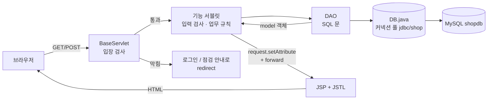

# 01. 구조 — 요청 하나가 지나가는 길

## 핵심 한 문장

**브라우저 → 서블릿(검사 · 규칙) → DAO(SQL) → MySQL → 모델 객체 → JSP(화면)** 순서로 흐른다. MVC 그대로다.

## 그림



## 계층별 역할

| 계층 | 패키지 / 폴더 | 하는 일 | 하지 않는 일 |
|---|---|---|---|
| Controller | `shop.service` | 파라미터 읽기, 검사, 트랜잭션, 화면 고르기 | SQL 쓰기 |
| Model | `shop.dao` · `shop.model` | SQL 실행, 결과를 객체로 | 화면 · 세션 |
| View | `WebContents/**/*.jsp` | EL · JSTL 로 그리기만 | DB 접근 (스크립틀릿 없음) |
| LLM | `shop.llm` | AI 호출, 백그라운드 요약 | 화면 그리는 중에 AI 부르기 |

## 모든 요청이 거치는 BaseServlet

모든 서블릿은 `BaseServlet` 을 상속한다. `doGet` / `doPost` 는 BaseServlet 에만 있고, 자식은 `get()` / `post()` 만 쓴다.

```
doGet/doPost → run() → allowed() 입장 검사
                         ├ 점검 모드면 → /maintenance
                         ├ /admin/** 인데 ADMIN 아님 → 로그인 또는 홈으로
                         ├ /cart · /order · /mypage · /wish 인데 USER 아님 → 로그인 또는 홈으로
                         └ 통과 → get() 또는 post()
```

- 공통 도우미도 여기 있다: `param()`(앞뒤 공백 제거), `intParam()`, `flash()`(1회용 알림), `render()`(JSP forward), `redirect()`
- 잘못된 입력은 `throw new Fail("메시지")` 로 던지고, 서블릿이 잡아서 알림으로 보여 준다.

## URL 매핑 규칙

- `@WebServlet({"/cart/list", "/cart/add", …})` 처럼 **정확한 주소만** 매핑한다.
- `/cart/*` 같은 와일드카드를 안 쓰는 이유: JSP 폴더 이름과 겹쳐서 forward 가 다시 같은 서블릿으로 돌아오는 **무한 순환**이 생긴다.

## DB.java — DAO 의 공통 도우미

| 기능 | 방법 |
|---|---|
| 커넥션 | JNDI 로 `jdbc/shop` 풀을 찾아 빌려 쓰고 바로 반납 |
| 결과 → 객체 | 컬럼 `product_name` → 필드 `productName` 에 **리플렉션**으로 채움 |
| 트랜잭션 | `DB.begin()` → 같은 스레드는 같은 커넥션(`ThreadLocal`) → `DB.commit()` → `finally DB.end()` |
| 안전 | 모든 SQL 은 `PreparedStatement` 의 `?` 바인딩 → SQL 인젝션 방지 |

`DB.end()` 는 commit 안 했으면 **rollback** 하고 커넥션을 돌려준다. 그래서 중간에 예외가 나면 자동으로 전부 취소된다.

## 화면(View) 쪽

- 모든 JSP 는 `common/header.jsp` · `footer.jsp` 를 `<%@ include %>` 로 붙인다.
- 팝업(리뷰 · 문의 · 배송지 · 운송장 등)은 별도 페이지 없이 `<dialog>` 로 열고 부모 화면 주소로 제출한다.
- JS 는 7개: `ui.js`(공통) · `validate.js`(폼 검사) · `custom.js`(조합 계산) · `banner.js` · `prodtabs.js` · `llm.js`(AI 추천) · `postcode.js`(우편번호)
- 폼 검사는 **두 번**: 브라우저(`validate.js`)는 편의용, 진짜 판정은 서버(`MemberServlet` 등). 규칙 문자열이 둘 다 같다.
