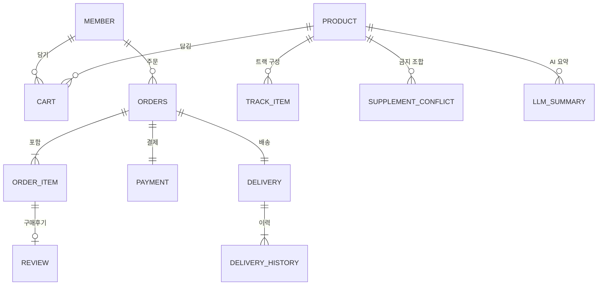

# 02. DB — 테이블과 관계

## 핵심

테이블 **22개** · 뷰 **5개** · FK 29 · UNIQUE KEY 12 · CHECK 10 (`sql/schema.sql` 을 직접 센 값. README 표기 "UNIQUE 11 · CHECK 6" 은 옛 숫자). 설계 이유는 schema.sql 주석에 있다.

## 덩어리로 외우기

| 덩어리 | 테이블 | 한 줄 |
|---|---|---|
| 회원 | `member` · `address` | 탈퇴는 `status='LEFT'` (소프트 삭제) |
| 상품 | `category` · `product` · `track_item` · `product_image` · `supplement_conflict` | 트랙 = 낱개 묶음, 금지 조합 = 낱개 2개 쌍 |
| 담기 | `cart` · `wishlist` · `combo` · `combo_item` | cart.quantity = **섭취 일수** |
| 주문 | `orders` · `order_item` · `payment` · `delivery` · `delivery_history` | 주문 1건 = 결제 1 · 배송 1 |
| 게시판 | `review` · `qna` · `notice` | 리뷰는 주문 상품 1개당 1번 |
| 운영 | `system_config` · `admin_log` · `llm_summary` | 설정값, 관리자 기록, AI 요약 저장 |

## 관계 그림 (주요만)

## 설계 포인트 (발표에서 말할 것)

1. **주문 상품은 스냅샷**: `order_item` 에 상품 이름 · 가격 · 트랙 구성을 **주문 당시 값으로 복사**한다. 나중에 상품 가격이 바뀌어도 주문 내역은 그대로.
2. **금지 조합은 한 방향만 저장**: `product_a < product_b` (CHECK). (A,B) 와 (B,A) 가 중복으로 들어가지 않는다. MySQL 은 CASCADE 가 걸린 FK 컬럼에 CHECK 를 못 걸게 해서(ERROR 3823), 일부러 FK 를 RESTRICT 로 두었다.
3. **배송 단계 순서 강제**: 결제완료 → 상품준비 → 배송중 → 배송완료. 배송중 · 배송완료는 운송장이 있어야 한다 (CHECK).
4. **리뷰 1회 제한**: `review.item_id` 가 UNIQUE → 같은 구매 건에 리뷰 두 번 불가.
5. **설정은 테이블로**: 배송비 · 무료배송 기준 · 재고 부족 기준 · 최대 섭취 일수 · 점검 모드를 `system_config` 에서 읽는다. 코드 수정 없이 바뀐다.

## 주요 SQL

| 장면 | SQL (요약) | 포인트 |
|---|---|---|
| 판매 중 상품만 | `WHERE p.status='판매중' AND p.stock > 0` | `ProductDAO.ON_SALE` 한 줄을 목록 · 상세 · 조합이 같이 씀 |
| 장바구니 담기 | `INSERT INTO cart … ON DUPLICATE KEY UPDATE quantity = ?` | 같은 상품 다시 담으면 일수를 새 값으로 |
| 재고 차감 | `UPDATE product SET stock = stock - ? WHERE product_id = ? AND stock >= ?` | 0행이면 재고 부족 → 전체 rollback |
| 배송 단계 | `UPDATE delivery SET status = ? … WHERE delivery_id = ? AND status = <직전 단계>` | 한 칸씩만, 동시에 두 번 눌러도 한 번만 |
| 주문 번호 | `CONCAT(DATE_FORMAT(ordered_at,'%Y%m%d'), '-', LPAD(order_id,4,'0'))` | 예: `20261124-1264` |

## 뷰 5개

| 뷰 | 쓰는 곳 |
|---|---|
| `v_sales_daily` | 관리자 대시보드 일별 매출 |
| `v_delivery_status_count` | 대시보드 배송 단계별 건수 |
| `v_low_stock` | 대시보드 재고 부족 |
| `v_admin_order` | 관리자 주문 목록 (회원 · 결제 · 배송 · 첫 상품명) |
| `v_admin_member` | 관리자 회원 목록 (주문 수 · 결제 합계) |
