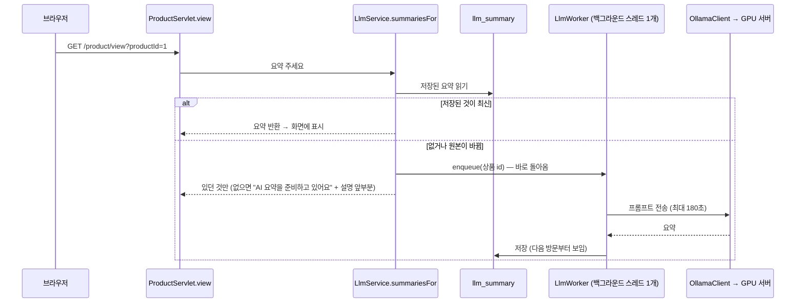

# 10. 기능 — AI 요약 · 연관 추천

## 핵심

AI 응답은 수십 초 ~ 3분 걸린다. 그래서 **화면을 그릴 때는 절대 AI 를 부르지 않는다.**
- 요약(설명 · 리뷰): **미리 만들어 DB 에 저장**해 두고 읽기만 한다 → 백그라운드 일꾼이 만든다.
- 연관 추천(검색어별): 미리 못 만드니까 **화면이 뜬 뒤 JS 가 비동기로** 요청한다.

## 1) 설명 · 리뷰 요약 (F1 · F2)



- **"최신인지" 판단 = `source_key`**: 원본(설명 또는 리뷰 목록)의 SHA-256 해시를 같이 저장. 원본이 바뀌면 해시가 달라져 다시 만든다. → `LlmService.isCurrent()`
- 설명 요약은 원본이 바뀌면 **옛 요약을 숨긴다** (틀린 말이 될 수 있어서). 리뷰 요약은 새 것이 나올 때까지 **옛 것을 보여 준다**.
- 리뷰 요약은 JSON(`good` · `caution` 목록)으로 받아 "좋았던 점 / 주의할 점" 으로 나눠 보여 준다.
- `LlmWorker` 는 `@WebListener` — 톰캣이 앱을 올릴 때 스레드 1개를 만들고, 내릴 때 정리한다. 같은 상품은 줄에 두 번 서지 않는다.
- 관리자 "AI 요약 전체 생성" → 판매 중 상품 전부를 줄에 세움.

## 2) 연관 상품 추천 (F3)

| 단계 | 내용 |
|---|---|
| 화면 | 상품 목록에서 검색했을 때 아래쪽 "AI 추천" 칸 |
| 호출 | `js/llm.js` → `fetch GET /llm/related?keyword=…` (JSON) |
| 서버 | `LlmServlet.get()` → `LlmService.findRelated()` → `LlmCache.related()` |
| 캐시 | 같은 검색어(정규화 후)는 메모리에 저장. **같은 검색어가 동시에 들어오면 한 번만** AI 를 부르고 나머지는 기다림 |
| 동시 호출 제한 | `Semaphore` 로 GPU 동시 요청 수를 제한 |
| 실패 | `{"ok": false, "message": "…"}` → `llm.js` 가 AI 추천 칸을 **숨긴다** (추천이 없을 때도 숨김). 검색 결과는 정상 |

## 3) 연결 구조

```
OllamaClient ─HTTP POST─▶ localhost:31434 (context.xml 의 llm/ollamaUrl)
                          └ k8s 중계 파드 ─▶ 학교 GPU 서버 Ollama (gemma3:12b)
```

- 학교 GPU 서버는 학교 IP 만 받기 때문에 중계를 거친다 (`tools/llm/start-relay.sh`).
- 요청: `{"model": …, "prompt": …, "stream": false}` — Java 17 내장 `HttpClient`, 연결 10초 · 응답 180초 제한.
- 설정이 없거나 서버가 꺼져 있어도 **쇼핑몰은 정상 동작**한다 (요약 칸은 "준비 중" 안내 + 설명 앞부분, 추천 칸은 숨김).

## 발표 포인트

- "느린 외부 의존성을 화면 경로에서 떼어 냈다" — 저장형(요약)과 비동기형(추천)으로 나눈 이유를 설명할 수 있으면 충분하다.
- 과제 규칙상 외부 API 는 금지지만, 학교 GPU 서버 LLM 호출 하나만 예외로 허용됐다.
